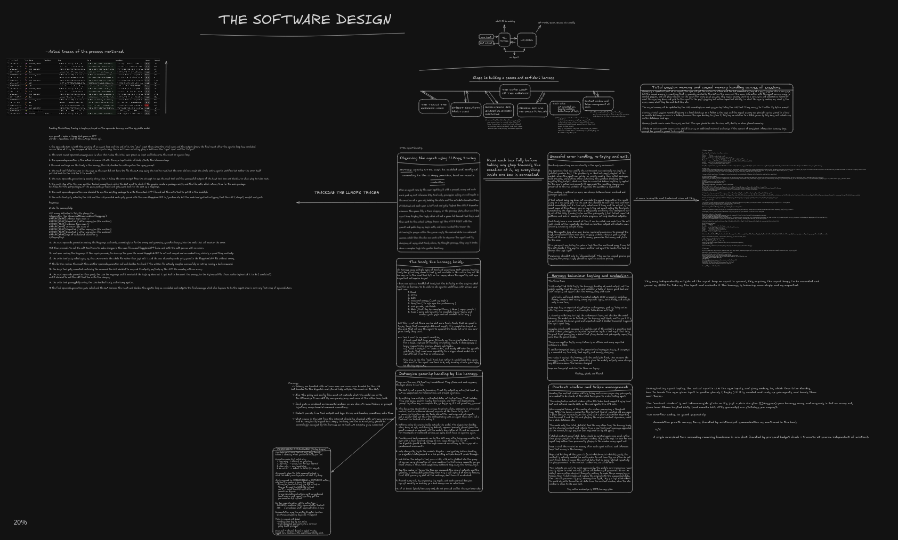

# optine

optine is a local first, open source terminal agent for self hosted LLMs.
It runs locally, talks to Ollama or vLLM, and can also reach hosted models
through OpenRouter when you supply a key. It gives the model tools while
keeping every mutating action behind your approval.

## What optine does

optine opens on a launcher: the optine banner and the commands that start a
session. Type / to pick one from an interactive list, or type it out. /local
starts on a running local provider and /remote on a hosted OpenRouter model;
providers, models and connections are chosen from arrow-key lists, and API keys
are typed without being echoed. optine probes your models, checks whether they support tool
calling, and drops you into a terminal interface where the model can search the
web, read files, edit files, create files and run bash commands. Models with
native tool calling use it directly. Models without it fall back to a JSON
envelope protocol, so small local models get the same harness. Inside the
interface, /model switches the model and rewrites the session's system prompt
for the new tool mode. Every conversation is a session: history, the system
prompt and file snapshots are saved as you go, /resume brings one back after a
restart, and /revert restores the files from the latest run.

## Features

1. Provider loops for Ollama, vLLM and OpenRouter, with a JSON envelope fallback for models without native tool calling on all three
2. Five tools: web_search, read_file, bash, edit_file, write_file
3. A bash classifier that parses every command into the paths it touches and the effects it has, and denies anything it cannot analyze
4. Shared directory approvals for the file tools, plus session scoped grants per exact command and directory for bash
5. A JSONL audit log recorded before any action executes
6. Long term casual memory the model keeps in a plain file you can watch
7. In-session /model switching: optine re-probes the chosen model's tool support and context window and rewrites the session's system prompt for the matching protocol
8. A terminal interface with a / command palette (filtered as you type, arrow keys, tab to complete, clickable) that offers only the commands of the current session, local or remote, plus clickable approval prompts, interactive model and session pickers, markdown output, copy shortcuts and cached conversation rendering
9. Sessional memory: conversation history, the tool-call mode and the composed system prompt are saved under your user config directory and reloaded with /resume, including the snapshot backend chosen when the session started, and replayed in the TUI
10. Before/after file snapshots for every run and /revert to restore changed or deleted files from the latest run and remove files it created
11. /effort to set how hard the model reasons, on Ollama, vLLM and OpenRouter models that support it, saved with the session

## The Planned Implementation Diagram.



The link to it: [Excalidraw](https://excalidraw.com/#room=2399978c9a0befade30e,oUWfzHSql_iSfuXOmRaTzA)


## Requirements

1. Go 1.27.4, pinned in go.mod
2. Linux or macOS for the bash tool
3. Ollama running on localhost:11434, or vLLM on localhost:8000
4. Optional: an OpenRouter API key, set with /connect, to run hosted models
5. Optional: git for the git-backed snapshot backend; without it, snapshots use a content-addressed store

## Build and run

```
go build ./...
./optine
```

Type /local to start on a local model, or /remote to start on a hosted
OpenRouter model (set a key with /connect first). Typing / at the launcher or
inside a session lists the commands available there. Inside the interface,
/model switches models, /new starts an empty session, /resume reopens a saved
session, /revert restores files from the latest run, /redo puts that run's
changes back after a /revert, /rewind takes the conversation and files back
to before one of your messages, /effort sets how hard the model reasons, and
/quit exits optine;
ctrl+c leaves the session and returns to the launcher. /help lists every
command. Without a terminal (piped input), the launcher falls back to plain
lines and numbered lists.

## Sessions

Each conversation is a session with its own UID. The full history, in a
provider-neutral format, is saved after every run under your user config
directory, for example ~/.config/optine/sessions/ on Linux, along with the
provider, model, directory and prompt token count. Sessions are written
atomically, so quitting early cannot leave half a file behind.

Run /resume before the terminal interface starts to load the newest saved
session for the current working directory. Inside the interface, /resume opens
an interactive picker of saved sessions showing each model, its number of user
turns and when it was last saved; picking one replaces the transcript with that
conversation, so the previous user and assistant messages are visible in
context. A session records the directory it started in, because both the tools
and the snapshot history belong to that working directory.

A session also stores its tool-call mode and its composed system prompt, so a
resumed run continues with the same protocol and prompt it was saved with.

The snapshot backend is chosen once when a session is created and stored with
it. Resuming never re-detects git, so a session created with git snapshots
keeps them, and a session created with content-addressed snapshots keeps those,
even if git is installed or removed later.

## System prompts

Each session has a single system prompt, composed from the tool protocol
(native tool calling or the JSON envelope), the available crawlers, the casual
memory notebook and the model's turn budget. It is written to the session file,
so a resumed run picks up the same prompt. optine rebuilds and re-saves it when
its inputs change: the notebook is edited, crawler availability changes, or
/model switches the model's tool support.

## Reverting files

optine captures the working directory before and after every agent run, using
the session's saved snapshot backend. /revert uses the latest complete pair to
put changed or deleted files back and remove files created by that run.
Snapshots belong to the session, so this works after /resume as long as you
are in the same directory. /revert only touches files; it does not remove
messages from the transcript. /redo undoes a /revert, putting the latest
run's changes back.

If the latest run has only a before snapshot or no snapshots at all, /revert
leaves the working directory alone and reports that there is no complete pair
to restore.

## Rewinding

/rewind opens a picker of the messages you sent in this session, newest
first. Picking one cuts the conversation on screen back to just before it and
puts that message back in the prompt, so you can edit and resend it. The files
and the saved session are left alone until you send your next message; then
every run from the picked message on is undone, newest first, the history is
cut there and saved, and your message runs on the rewound conversation.
Leaving or switching sessions before that discards the rewind. A run without a
complete snapshot pair is reported and its files are left as they are.

## Effort

/effort opens a picker of the reasoning levels the current model accepts, with
the current level first; /effort high sets one directly. default sends nothing
and lets the model decide, off turns reasoning off where the model allows it,
and models that can only switch thinking on or off get on and off instead of
levels. The level shows on the header line, is saved with the session and
comes back with /resume and /new. /model keeps it: a model that does not take
it gets nothing sent, and the level returns on the next model that does.

| Provider | Request field | Levels | How optine learns support |
| --- | --- | --- | --- |
| OpenRouter | reasoning.effort | the model's listed levels: minimal, low, medium, high, xhigh, max; off sends none | the model's reasoning entry in the catalog |
| Ollama | think | the model's levels, or on and off; off sends false | the thinking values from /api/show |
| vLLM | reasoning_effort | low, medium, high; off sends none | one short probe request when the model is picked |

vLLM must be started with --reasoning-parser for the probe to see reasoning,
and what each level does is up to the model's chat template. The model's
reasoning text is not shown in the interface.

## Approvals

When the model wants to run something risky, optine asks. Answer y to allow
it once, a to remember it, or anything else to deny. A granted bash command
is remembered as that exact command in that exact directory for this session,
never as the whole tool. For file tools, a approves that directory for all of
read_file, edit_file and write_file, and safe bash reads and writes there, for
the rest of the process. Sensitive file reads, edits and writes always prompt,
even when their directory is approved; bash refuses sensitive paths outright.

## The safety model

The workspace root is set once at startup from your working directory, and
the model never chooses it. Every bash command is parsed into a list of
actions with read, write, delete, network and exec classes. Reads and writes
inside the workspace run without a prompt unless the path is sensitive, and
safe reads and writes are also allowed in directories you approve with a file
tool. Anything outside stays behind a prompt; delete, network and exec actions
always ask because their effects cannot be fully known. File writes are create
only, and any symlink in the parent chain is rejected, so the model cannot
write through a link you never checked. Every decision is recorded before the
action runs, and if the record cannot be written, the action does not run. Bash
grants are exact and session scoped; directory approvals from file tools are
shared with the other file tools and safe bash reads and writes for the rest of
the process.

The audit log, the memory notebook, saved sessions and file snapshots live in
your user config directory under optine, for example ~/.config/optine/audit.jsonl,
casualMemory.md, sessions/ and the snapshot stores on Linux.

## Project layout

1. internal/harnessCore, the provider agent loops, including recovery tests for malformed replies
2. internal/harnessSession, session history, system prompt cache and disk persistence
3. internal/harnessSnapshotter, git and content-addressed file snapshots plus revert
4. internal/harnessDispatch, tool call routing
5. internal/harnessPermissions, the classifier, path policies, approvals and the audit log
6. internal/harnessTools, tool execution
7. internal/harnessMemory, the casual memory notebook
8. internal/systemPrompts, prompt text
9. internal/approval, the "a human answer is needed" bridge between the harness and the active interface
10. internal/provider, server probing and capability checks
11. internal/dataTypes, the shared provider request, response and message types
12. internal/cli, the launcher, the provider, model and session pickers
13. internal/tui, the terminal interface, the launcher widgets and the command palette
14. internal/slashCommands, the one list of slash commands per scope (launcher, local session, remote session)

## Status

Early alpha, built solo by Matthew Baroi. optine is past the skeleton stage and
runs end to end on Ollama, vLLM and OpenRouter, with five tools, approvals and
an audit log, before/after snapshots with /revert, persisted sessions that
survive restarts and reopen through an interactive /resume picker, in-session
/model switching that rewrites the saved system prompt, and a cached terminal
interface. Planned next: transcript undo, transcript compaction, a bash
sandbox, and hosted OpenAI and Anthropic providers (their /connect keys are
stored today, but those loops are still under development).

## License

MIT. See LICENSE.
